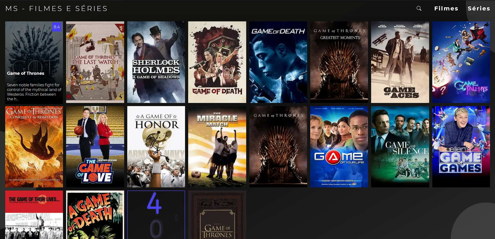

# MS - Movies and Series

### Look for information about movies and TV shows

**MS is a responsive website built with React, Next.js, SWR, SASS and serverless functions that query imdb and tmdb APIs**

[MS - Movies and Series](https://ms-movies.vercel.app/)

## Local setup

1. Use Node.js 24 LTS (`nvm install` and `nvm use` if using nvm) and Yarn 1.
2. Install dependencies with `yarn install --frozen-lockfile`.
3. Copy `.env.example` to `.env.local` and set `API_KEY` to a TMDB API key. The optional `RAPIDAPI_KEY` enables the IMDb rating; without it, the rest of the detail page still works. If you already have an environment file, add the four provider base URLs shown in `.env.example` without replacing your keys.
4. Run `yarn dev` and open `http://localhost:3000`.

The application uses Next.js 16 and React 19. See the [modernization plan](MODERNIZATION_PLAN.md) for the remaining work. `API_KEY` and the provider base URLs are required at build and runtime, since discovery pages are generated during the build. `TMDB_API_BASE_URL` and `IMDB_API_BASE_URL` remain server-only. The image and YouTube base URLs are public and embedded in browser code at build time: rebuild after changing them. All base URLs must be HTTPS and contain no credentials, query, or fragment. Never put keys in `NEXT_PUBLIC_` variables or commit real values.

Run `yarn lint`, `yarn typecheck`, and `yarn test` for the automated checks. `typecheck` regenerates Next.js route types before running TypeScript. To check production rendering without provider credentials, run `yarn build:mock` followed by `yarn test:smoke`. For browser interaction checks, install Chromium with `yarn playwright install --no-shell chromium` and run `yarn test:e2e` against that same mock build. On Linux, Playwright's `--with-deps` option installs required system libraries.

The mock build writes fixture data to `.next` and must not be deployed; run `yarn build` with a real key for a deployment build. Smoke and browser tests use mocked provider responses and do not replace testing with real TMDB data. The browser tests start their own fixture server on port 3210; set `E2E_PORT` if that port is in use.

The watchlist is local to the browser. Existing `ToWatchList` and `itemsId` cookies are validated and imported into versioned browser storage on the same origin; the original cookies are left unchanged as a recovery copy. If the app warns that data is unreadable or storage is unavailable, do not clear browser data: the original cookies or stored data have been retained. Changes made after migration are not written back to the legacy cookies, so rolling back to an older app can show an older list.

**Security:** Earlier versions of this repository contained TMDB and RapidAPI credentials. Rotate or revoke them in the provider dashboards and review account usage. Removing keys from source does not invalidate them or remove them from Git history.

**Screenshots**

    
 

  
 

  
 

  
