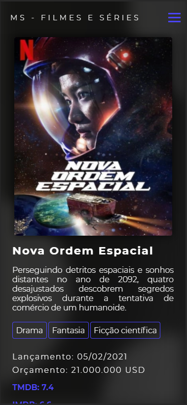
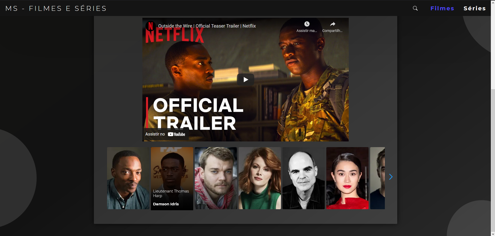

# MS - Filmes e Séries

### Look for information about movies and TV shows

**MS is a responsive website built with React, Next.js, SWR, SASS and serverless functions that query imdb and tmdb APIs**

[MS - Filmes e Séries](https://ms-movies.vercel.app/)

## Local setup

1. Use Node.js 24 LTS (`nvm install` and `nvm use` if using nvm) and Yarn 1.
2. Install dependencies with `yarn install --frozen-lockfile`.
3. Copy `.env.example` to `.env.local` and set `API_KEY` to a TMDB API key. The optional `RAPIDAPI_KEY` enables the IMDb rating; without it, the rest of the detail page still works.
4. Run `yarn dev` and open `http://localhost:3000`.

The application uses Next.js 16 and React 19. See the [modernization plan](MODERNIZATION_PLAN.md) for the remaining work. `API_KEY` is required for the production build as well as at runtime, since discovery pages are generated during the build. Configure server-only environment variables in the deployment platform; do not prefix them with `NEXT_PUBLIC_` or commit real values.

Run `yarn typecheck` and `yarn test` for the current automated checks. To check production rendering without provider credentials, run `yarn build:mock` followed by `yarn test:smoke`. The mock build writes fixture data to `.next` and must not be deployed; run `yarn build` with a real key for a deployment build. These tests mock external APIs and do not replace browser-based testing of the main flows.

**Security:** Earlier versions of this repository contained TMDB and RapidAPI credentials. Rotate or revoke them in the provider dashboards and review account usage. Removing keys from source does not invalidate them or remove them from Git history.

**Screenshots**

    
 

  
 

  
 

  
